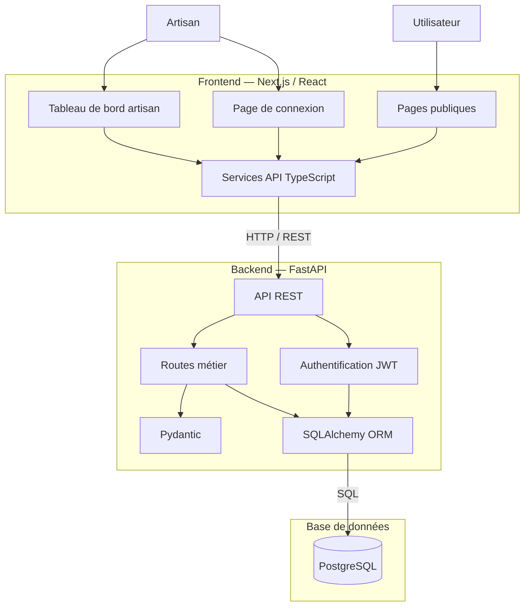
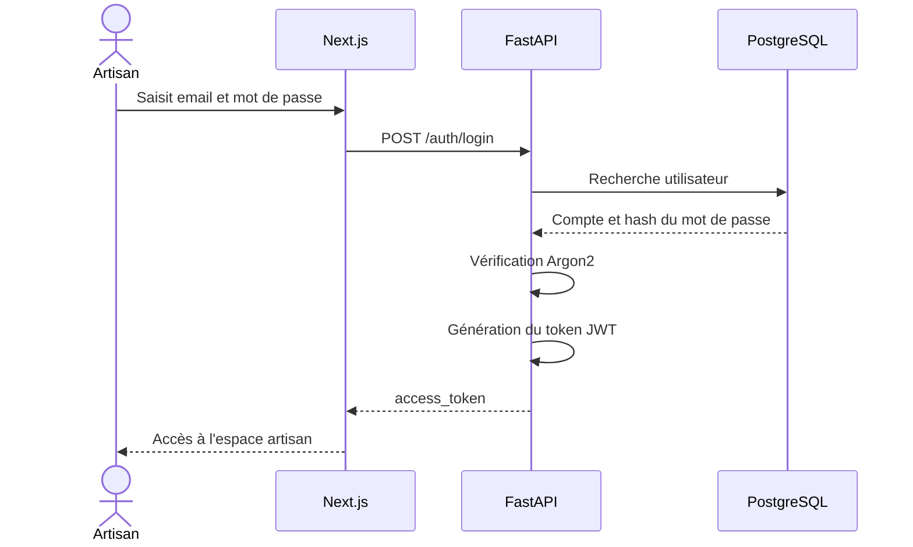
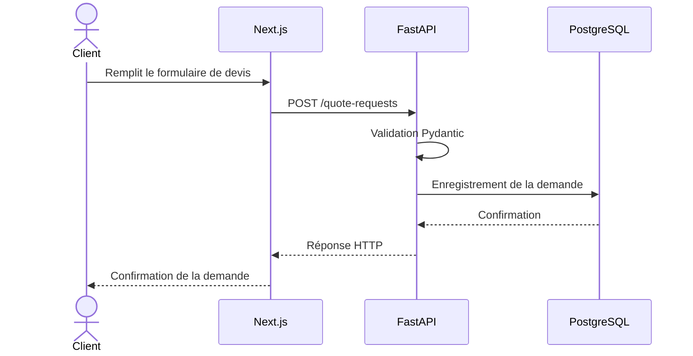
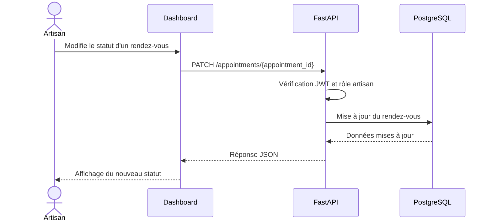

# Architecture technique — AzurRenoPro

## 1. Présentation

AzurRenoPro est une application web de gestion destinée aux artisans.

Elle repose sur une architecture séparant trois composants :

- **Frontend :** Next.js, React et TypeScript.
- **Backend :** FastAPI, Pydantic et SQLAlchemy.
- **Base de données :** PostgreSQL.

L'application propose une interface publique et un espace d'administration réservé à l'artisan.

## 2. Architecture générale



## 3. Architecture frontend

Le frontend est développé avec Next.js, React, TypeScript et Tailwind CSS.

Il est responsable de :

- L'affichage des pages publiques.
- La consultation des services.
- La soumission des formulaires de devis et de rendez-vous.
- La connexion de l'artisan.
- L'affichage du tableau de bord.
- La gestion des services, devis et rendez-vous.
- La communication avec l'API FastAPI.

### Pages principales

| Route | Fonction |
|---|---|
| `/` | Accueil |
| `/services` | Catalogue des services |
| `/quote` | Demande de devis |
| `/appointment` | Prise de rendez-vous |
| `/login` | Connexion artisan |
| `/dashboard` | Tableau de bord |
| `/dashboard/quotes` | Gestion des devis |
| `/dashboard/appointments` | Gestion des rendez-vous |
| `/dashboard/services` | Gestion des services |

Le frontend utilise la variable d'environnement :

```env
NEXT_PUBLIC_API_URL=http://127.0.0.1:8000
```

## 4. Architecture backend

Le backend est développé avec FastAPI.

Il est organisé en plusieurs modules :

- `api/` : endpoints REST.
- `core/` : configuration et sécurité.
- `db/` : connexion à la base de données.
- `models/` : modèles SQLAlchemy.
- `schemas/` : validation des données avec Pydantic.
- `main.py` : initialisation de l'application FastAPI.

### Responsabilités

- Recevoir les requêtes HTTP.
- Valider les données.
- Appliquer les règles métier.
- Gérer l'authentification.
- Contrôler les autorisations.
- Lire et modifier les données PostgreSQL.
- Retourner les réponses JSON.

## 5. Authentification et sécurité

L'espace artisan utilise une authentification JWT.

### Diagramme de connexion



### Protection des routes

Les opérations d'administration nécessitent un token JWT valide.

```http
Authorization: Bearer <token>
```

Le backend vérifie :

1. La validité du token.
2. L'identité de l'utilisateur.
3. Le rôle `artisan`.
4. L'autorisation d'effectuer l'opération.

Les contrôles d'accès sont appliqués côté backend, indépendamment de l'interface frontend.

## 6. Flux des demandes de devis



## 7. Flux de gestion des rendez-vous



## 8. Base de données

La base PostgreSQL contient quatre entités principales :

- `Service`
- `QuoteRequest`
- `Appointment`
- `User`

SQLAlchemy permet de représenter les tables sous forme de modèles Python.

Psycopg assure la communication avec PostgreSQL.

Le schéma détaillé est disponible dans :

[Documentation de la base de données](database.md)

## 9. Environnement de développement

| Composant | Technologie | Port |
|---|---|---|
| Frontend | Next.js | 3000 |
| Backend | FastAPI / Uvicorn | 8000 |
| Base de données | PostgreSQL / Docker | 5432 |

Le projet utilise Docker Compose pour démarrer PostgreSQL localement.

## 10. Tests et intégration continue

Le backend est testé avec Pytest.

**Dernier résultat confirmé : 23 tests réussis.**

Le frontend a passé la compilation de production Next.js.

GitHub Actions automatise les vérifications du backend et du frontend.

Les fonctionnalités ont été intégrées à la branche `main` via des Pull Requests.

## 11. Conclusion

L'architecture d'AzurRenoPro sépare clairement les responsabilités entre l'interface utilisateur, l'API REST et la base de données.

Cette organisation facilite :

- La maintenance du code.
- L'ajout de fonctionnalités.
- Les tests automatisés.
- La protection des opérations d'administration.
- L'évolution future du MVP.

**État : architecture du MVP final documentée pour le Stage 4.**
