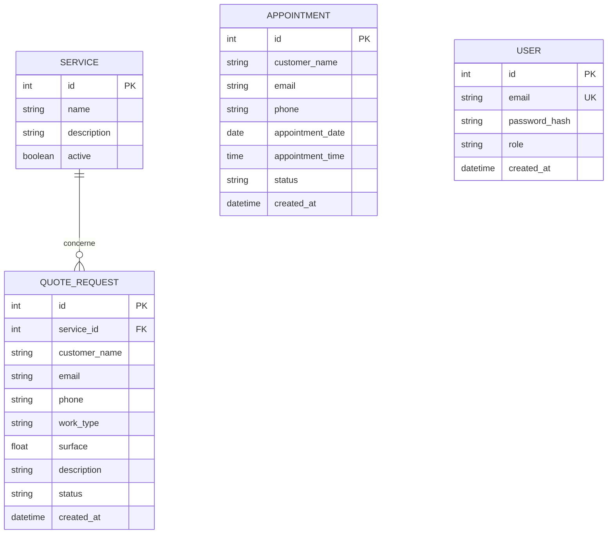

# Schéma de la base de données — AzurRenoPro

## 1. Présentation

Le MVP AzurRenoPro utilise PostgreSQL comme système de gestion de base de données relationnelle.

L'accès aux données est assuré par SQLAlchemy et Psycopg depuis le backend FastAPI.

La base de données contient quatre entités principales :

- `Service` : prestations proposées par l'artisan.
- `QuoteRequest` : demandes de devis envoyées par les clients.
- `Appointment` : rendez-vous demandés par les clients.
- `User` : comptes utilisateurs permettant l'accès au back-office.

## 2. Diagramme entité-relation

## 3. Description des entités

### Service

La table `Service` contient les prestations proposées par l'artisan.

| Champ | Type | Description |
|---|---|---|
| id | Integer | Identifiant unique |
| name | String | Nom du service |
| description | String | Description de la prestation |
| active | Boolean | Indique si le service est actif |

La propriété `active` permet de gérer l'affichage des services disponibles.

### QuoteRequest

La table `QuoteRequest` enregistre les demandes de devis.

| Champ | Type | Description |
|---|---|---|
| id | Integer | Identifiant unique |
| service_id | Integer | Référence vers un service |
| customer_name | String | Nom du client |
| email | String | Adresse email |
| phone | String | Numéro de téléphone |
| work_type | String | Type de travaux |
| surface | Float | Surface concernée |
| description | String | Description de la demande |
| status | String | Statut du devis |
| created_at | DateTime | Date de création |

Les statuts utilisés sont :

- `pending`
- `accepted`
- `rejected`
- `completed`

### Appointment

La table `Appointment` enregistre les demandes de rendez-vous.

| Champ | Type | Description |
|---|---|---|
| id | Integer | Identifiant unique |
| customer_name | String | Nom du client |
| email | String | Adresse email |
| phone | String | Numéro de téléphone |
| appointment_date | Date | Date du rendez-vous |
| appointment_time | Time | Heure du rendez-vous |
| status | String | Statut du rendez-vous |
| created_at | DateTime | Date de création |

Les statuts utilisés sont :

- `pending`
- `confirmed`
- `cancelled`
- `completed`

### User

La table `User` contient les informations nécessaires à l'authentification de l'artisan.

| Champ | Type | Description |
|---|---|---|
| id | Integer | Identifiant unique |
| email | String | Adresse email unique |
| password_hash | String | Mot de passe haché |
| role | String | Rôle de l'utilisateur |
| created_at | DateTime | Date de création |

Le rôle `artisan` permet d'accéder aux fonctionnalités protégées du back-office.

Le mot de passe n'est pas stocké en clair : seul son hash Argon2 est enregistré.

## 4. Relations entre les tables

### Service et QuoteRequest

Une demande de devis est associée à un service grâce à la clé étrangère `service_id`.

La relation est de type **un-à-plusieurs** :

- Un service peut être associé à plusieurs demandes de devis.
- Une demande de devis référence un service.

### Appointment

Dans le MVP actuel, les rendez-vous sont indépendants des demandes de devis.

Aucune relation directe entre `Appointment` et `QuoteRequest` n'est définie.

### User

La table `User` est utilisée pour l'authentification et les autorisations.

Dans le MVP actuel, aucune clé étrangère ne relie directement `User` aux trois autres tables.

L'accès aux opérations d'administration est contrôlé par le backend FastAPI.

## 5. Gestion des données

Le backend utilise SQLAlchemy pour effectuer les opérations sur les données :

- Création des enregistrements.
- Consultation des enregistrements.
- Modification des informations.
- Mise à jour des statuts.
- Gestion des services actifs et inactifs.

Les données sont conservées dans PostgreSQL.

## 6. Sécurité

Les principales mesures mises en place sont :

- Hachage des mots de passe avec Argon2.
- Authentification par JWT.
- Vérification du rôle `artisan`.
- Protection des endpoints d'administration.
- Validation des données avec Pydantic.
- Configuration de la connexion à PostgreSQL via les variables d'environnement.

Les tokens JWT ne sont pas stockés dans la table `User`.

## 7. Évolutions possibles

Pour les prochaines versions du projet, plusieurs améliorations sont envisageables :

- Ajouter des migrations avec Alembic.
- Créer des comptes clients.
- Associer les rendez-vous à des utilisateurs.
- Ajouter des factures et des devis PDF.
- Conserver un historique des modifications.
- Ajouter des sauvegardes automatisées de PostgreSQL.

Ces évolutions ne font pas partie du MVP actuel.

## 8. Conclusion

Le modèle de données d'AzurRenoPro permet de gérer les prestations, les demandes de devis, les rendez-vous et les comptes artisans.

L'utilisation de PostgreSQL et SQLAlchemy facilite la maintenance et l'évolution de la base de données.

**État : schéma du MVP final documenté pour le Stage 4.**
